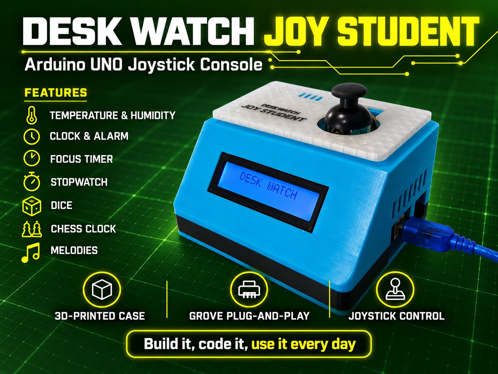
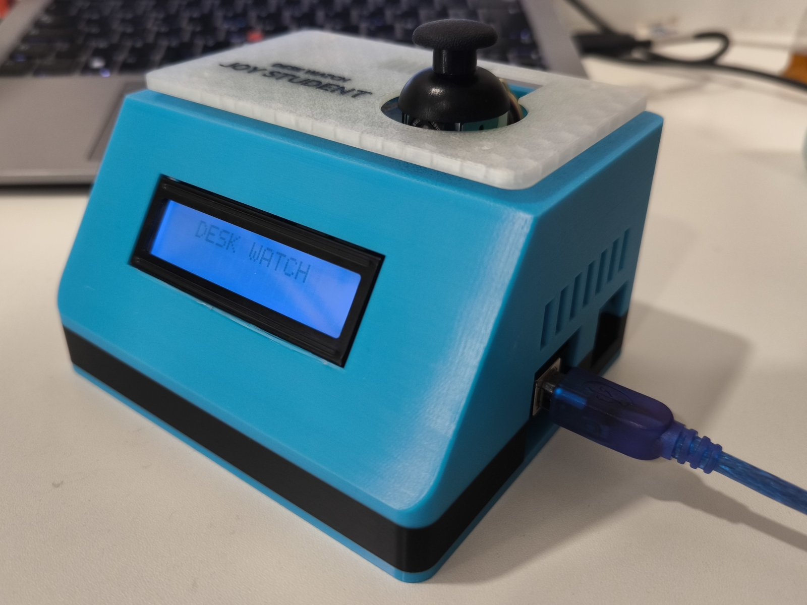
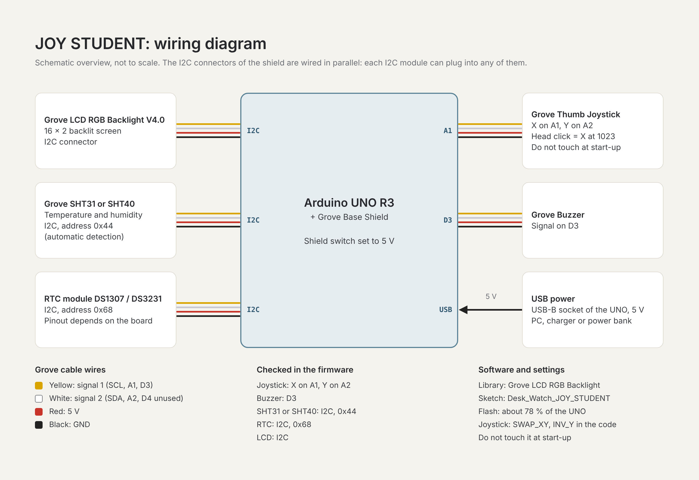
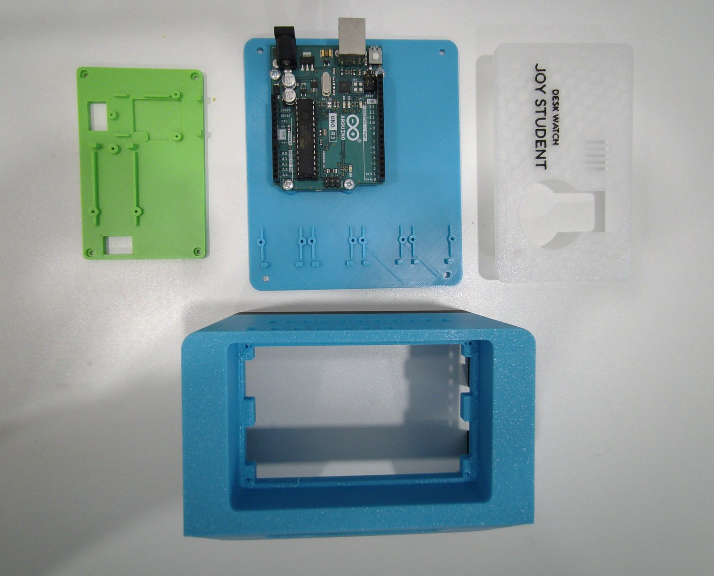

# Desk Watch JOY STUDENT

A compact desk console built around an **Arduino UNO R3**, a **Grove Base Shield** and one small **thumb joystick**. It shows temperature and humidity, warns you when the room goes out of range, and runs a Pomodoro timer, a stopwatch, a counter, a dice roller, a two-player chess clock and a melody player. Every module plugs in with a standard Grove cable, no soldering. Made for students, to build and use at home or in class.

*Version française : le schéma est dans `docs/wiring_FR.png`, les guides en français sont dans `docs/` et le firmware en français est dans `Desk_Watch_JOY_STUDENT_Edition_FR/`.*

## What it does

- Temperature and humidity on a 16x2 RGB LCD. The sensor can be a Grove **SHT31 or SHT40**: the firmware detects it automatically. Adjustable thresholds: the screen turns red, blue or green and the buzzer warns you.
- Menu of 11 entries: Favorite, Temp & Hum, Timer (Pomodoro), Counter, Stopwatch, Alarm, Dice, Chess clock, Melody, Settings, Screen sleep.
- Dice: D2 (coin flip) up to D100.
- Chess clock with several time controls and increment.
- Settings: brightness, volume, boot sound, automatic sleep, night mode, set time, favorite page.
- With the RTC module: clock on the home screen, alarm, automatic night mode (22:00 to 06:00, dimmed screen and silent alerts).
- Two firmware builds: English and French.

## One joystick, five gestures

| Gesture | Effect |
|---|---|
| Up / down | Scroll the menu or change a value (hold to repeat, faster after 1.5 s) |
| Right, or click on the stick | OK. Twice in less than 0.4 s: page action |
| Left | Back |
| Left held 2.5 s | Screen sleep |
| Chess clock running | Any move switches player |

Do not touch the joystick while the board powers up: its centre is measured at that moment.

## Hardware

| Part | Connection |
|---|---|
| Arduino UNO R3 + Grove Base Shield | USB-B for power and programming |
| Grove LCD RGB Backlight V4.0 (16x2) | I2C |
| Grove SHT31 or SHT40 temperature and humidity sensor (0x44) | I2C |
| Grove RTC, DS1307 or DS3231 (0x68) | I2C |
| Grove Thumb Joystick | A1 (X) and A2 (Y) |
| Grove Buzzer | D3 |

The LCD, the sensor and the RTC share the same I2C bus (different addresses), so the order of the I2C ports does not matter. The RTC gives the time, the alarm and the automatic night mode.

Screws: 13 x M1.7x5 (all the Grove modules), 4 x M2x20 (cover and tray), 4 x M3x6 (UNO), 4 x M3x12 countersunk (base to shell).

## Software

1. Install the **"Grove - LCD RGB Backlight"** library in the Arduino IDE (Library Manager). No other library is needed: the sensor and the RTC are read directly over I2C.
2. Open `Desk_Watch_JOY_STUDENT_Edition_EN/Desk_Watch_JOY_STUDENT_Edition_EN.ino` (or the `_FR` sketch for the French build). Each sketch sits in the folder of the same name, as the Arduino IDE requires.
3. Select *Arduino Uno* and upload.

The sketch uses about 78 % of the UNO flash and is commented, so you can read it and change it.

## Photos

## Documentation

- Assembly guide: [English](docs/EN_Desk_Watch_JOY_STUDENT_Assembly_Guide.pdf) | [Français](docs/FR_Desk_Watch_JOY_STUDENT_Guide_de_montage.pdf)
- User guide: [English](docs/EN_Desk_Watch_JOY_STUDENT_User_Guide.pdf) | [Français](docs/FR_Desk_Watch_JOY_STUDENT_Mode_d_emploi.pdf)

## 3D-printed case

The case (base, shell, tray and screw-on cover) is designed for a Bambu Lab printer and printed in PLA, one colour per part if you like. The 3D files and print profiles are only on MakerWorld:

https://makerworld.com/models/3490181

## Related projects

- [Desk Watch](https://github.com/PrBelamine/desk-watch): the original multi-app console with a rotary dial and a button.

## License

The sketches are released under the **GNU General Public License v3.0** (see `LICENSE`).

Made by a teacher at Pr. BELAMINE MakerLab, so it also works well as a first electronics and coding project for students, at home or with a teacher.
